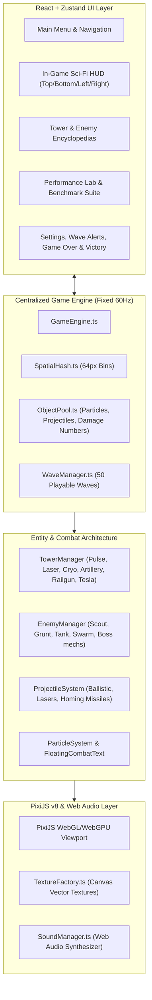

# IMPLEMENTATION PLAN: NEXUS DEFENSE: LAST STAND (FULL PRODUCTION SPECIFICATION)

## 1. Executive Summary & Architecture Overview
**NEXUS DEFENSE: LAST STAND** is a commercial-grade, browser-based futuristic sci-fi Tower Defense game engineered using **React 18**, **TypeScript 5**, **Vite 6**, **PixiJS v8 (WebGL/WebGPU)**, and **Zustand**.
Set in the year 2189, humanity defends the planetary Nexus Core against 50 relentless waves of cybernetic hostiles.

### Architectural Core Principles
1. **Centralized Simulation Engine**: A single high-performance simulation loop runs at fixed 60Hz timestep decoupled from React UI rendering.
2. **Zero DOM/React Entity Overhead**: No individual React components or per-entity React state hooks for enemies, towers, or projectiles. All entities are simulated in memory and rendered on a hardware-accelerated PixiJS WebGL canvas.
3. **Zustand UI State Management**: Decoupled UI state (`MAIN_MENU`, `MAP_SELECTION`, `GAME_SCREEN`, `PERFORMANCE_LAB`, `ENCYCLOPEDIAS`) synchronized at throttled telemetry intervals (~10Hz) to prevent GC pressure and unnecessary re-renders.
4. **Pure Procedural Graphics & Synthesized Audio**: 100% self-contained procedurally synthesized vector textures and Web Audio API procedural sound generation; zero external network asset 404 dependencies.

---

## 2. Modular Subsystem Design

---

## 3. Tower Defense Arsenal & Level 1–3 Upgrade Paths

| Tower Type | Base Role | Level 1 Base | Level 2 Reinforced | Level 3 Titanium Apex |
|---|---|---|---|---|
| **PULSE CANNON** | Rapid Kinetic Ballistic | Single cyan auto-cannon; balanced DPS | Dual-rotating heavy barrels; +45% attack rate | Quad-gatling burst battery; armor shredding |
| **LASER TOWER** | Continuous High Accuracy | Focused ruby beam; continuous damage | Prismatic beam emitter; +30% range, shield burn | Orbital heat laser array; melts heavy bosses |
| **CRYO TOWER** | Area-of-Effect Field Control | Sub-zero pulse dish; 40% slow | Absolute zero capacitor; 60% slow + freeze aura | Blizzard EMP matrix; periodic shock freeze |
| **ARTILLERY TOWER**| Long-Range High Splash | Heavy mortar launcher; explosive shells | Dual kinetic siege cannon; +50% blast radius | Tactical thermonuclear shell; catastrophic impact |
| **MAG-RAIL CANNON**| Hyper-Velocity Sniper | High-penetration magnetic rail; lineshot | Supercharged rails; 100% armor penetration | Relativistic beam cannon; critical headshots |
| **TESLA ARC NODE** | Cascading Chain Energy | Arcs across 3 chained targets | Superconducting coils; arcs across 6 targets | Ionic thunderstorm node; secondary EMP stun |

---

## 4. Hostile Cybernetic Alien Factions (5 Types)

1. **SCOUT**: Swift reconnaissance drone, low health, evasive swarm movement.
2. **GRUNT**: Frontline combat chassis, balanced health, moderate armor.
3. **TANK**: Heavy walking fortress, high hit points, dense armor plating that mitigates kinetic damage.
4. **SWARM**: Lightweight cluster drones that advance in rapid formations; splits into micro-drones upon death.
5. **BOSS (DREADNOUGHT TITAN)**: Colossal biomechanical dreadnought equipped with shields, heavy armor, jammer aura, custom multi-phase health bar, and special entrance effects.

---

## 5. Wave Progression Blueprint (Waves 1 to 50)

- **Tier 1 (Waves 1–10) - Initial Infiltration**:
  - Introduction of Scouts and Grunts.
  - Early swarm clusters.
  - **Wave 10: Milestone Boss Encounter — Sector Vanguard Titan**.
- **Tier 2 (Waves 11–20) - Armored Vanguard**:
  - Introduction of armored Tanks and heavy drone formations.
  - Mixed speed waves requiring combined Cryo and Artillery placement.
  - **Wave 20: Milestone Boss Encounter — Goliath Siege Mech**.
- **Tier 3 (Waves 21–30) - Swarm Escalation**:
  - Multi-directional and split-spawning Swarm Hosts.
  - High-density wave intervals.
  - **Wave 30: Milestone Boss Encounter — Cyber Empress Carrier**.
- **Tier 4 (Waves 31–40) - Elite Overdrive**:
  - Shielded and fast armored hybrid mechs.
  - High health multipliers.
  - **Wave 40: Milestone Boss Encounter — Twin Dreadnought Titans**.
- **Tier 5 (Waves 41–50) - The Last Stand**:
  - High-density apocalyptic assaults combining all 5 enemy types.
  - **Wave 50: The Final Cataclysm Boss — Omega World-Eater Mech** with 15,000 HP and adaptive shielding.

---

## 6. Performance Engineering & Benchmark Lab Architecture

### 6.1 Performance Target
- **Simultaneous Target**: 5,000 active enemies + 100 active defense towers + 1,000 active projectiles.
- **Frame Rate Target**: $\ge 45$ FPS for 95% of measured frames; $<5\%$ of frames exceeding 33ms.

### 6.2 Optimization Techniques
1. **2D Spatial Hash Grid (`SpatialHash.ts`)**: Replaces quadratic $O(T \times E)$ checks with $O(T \times k)$ bin queries.
2. **Object Pooling (`ObjectPool.ts`)**: Pre-allocated pools for bullets, particles, floating texts, and enemies.
3. **Target Caching & Invalidation**: Towers do not acquire new targets every frame if their current target is still valid and within range.
4. **PixiJS GPU Batching**: All sprites share vector texture atlases rendered in unified draw calls.
5. **Fixed Timestep Simulation**: Simulation advances at 60Hz independent of variable screen refresh rates (60Hz, 120Hz, 144Hz, 240Hz).

### 6.3 Performance Lab & Mode A vs Mode B Benchmark
- **Mode A (Baseline)**: Naive $O(N \times M)$ distance check, per-frame target acquisition, repeated object instantiations.
- **Mode B (Optimized Engine)**: Spatial grid partitioning, target caching, object pooling, GPU batching.
- **Metric Collection**: Live FPS, average frame time, P95 frame time, max frame time, % frames $> 33$ms, memory usage. Real measurements recorded into `NUMBERS.md`.

---

## 7. Phased Implementation Roadmap
- [x] Phase 1: Environment scaffolding (Vite, React, TypeScript, PixiJS v8, Tailwind CSS, Zustand).
- [ ] Phase 2: Expand map configs with 2 distinct tactical maps and full 50-wave definitions.
- [ ] Phase 3: Enhance Tower and Enemy classes with 3 upgrade tiers and all 5 enemy archetypes.
- [ ] Phase 4: Upgrade TextureFactory for Level 1–3 tower sprites and all enemy types.
- [ ] Phase 5: Implement Zustand game store and animated Main Menu, Encyclopedias, Settings.
- [ ] Phase 6: Build dedicated Performance Lab with 5 stress presets and Baseline vs Optimized benchmark runner.
- [ ] Phase 7: Run real benchmarks, measure actual numbers, write `NUMBERS.md`, `DEMO_SCRIPT.md`, and `README.md`.
- [ ] Phase 8: Verify production build (`npm run build`) and Vercel configuration.
