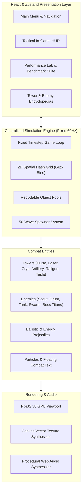

# NEXUS DEFENSE: LAST STAND ⚡🛡️

> A premium, high-performance, browser-based futuristic Sci-Fi Tower Defense game built from scratch using **React 18**, **TypeScript 5**, **Vite 6**, **PixiJS v8**, and **Zustand**.

---

## 🌌 1. Project Overview & Lore

The year is **2189**. Extraterrestrial cybernetic swarms and dreadnoughts have launched a catastrophic orbital incursion against humanity's final planetary bastion. At the epicenter of the defensive grid stands **The Nexus Core**—humanity's last remaining planetary energy reactor.

As Supreme Defense Commander, your mandate is to construct fortified defense arrays, prioritize weapon fire, manage tactical reserves, and survive **50 escalating hostile assault waves** across varied tactical battlefields.

---

## 🛠️ 2. Technology Stack & Dependencies

- **Frontend Framework**: [React 18.3.1](https://react.dev/)
- **Programming Language**: [TypeScript 5.7.3](https://www.typescriptlang.org/) (Strict mode enabled)
- **Build Tool & Bundler**: [Vite 6.4.5](https://vitejs.dev/)
- **Graphics & GPU 2D Engine**: [PixiJS v8.22.0](https://pixijs.com/) (Hardware-accelerated WebGL 2.0 / WebGPU Pipeline)
- **UI State Management**: [Zustand 5.0.3](https://zustand.docs.pmnd.rs/) (Decoupled navigation, settings, telemetry)
- **CSS & Design System**: [Tailwind CSS 3.4.17](https://tailwindcss.com/) with custom cyber/neon design tokens
- **Iconography**: [Lucide React 0.475.0](https://lucide.dev/)
- **Audio Synthesis**: Pure Web Audio API procedural synthesizer (zero external audio file dependencies)

---

## 🏛️ 3. Modular System Architecture



### Strict Architectural Separation
1. **Zero DOM / React Entity Overhead**:
   - Entities (`Enemy`, `Tower`, `Projectile`, `Particle`) are **never** rendered as React components.
   - High-frequency simulation state is simulated in memory and rendered on a WebGL canvas using PixiJS v8.
2. **Decoupled Telemetry Sync**:
   - React state sync occurs at throttled intervals (~10Hz) strictly for HUD readouts (credits, wave counter, core hull), eliminating React reconciliation bottlenecks.
3. **Pure Procedural Generation**:
   - Every single sprite, projectile, laser beam, particle, and tile is generated dynamically via HTML5 Canvas 2D vectors and cached into Pixi textures at runtime.
   - No external PNGs, GIFs, or MP3s are needed: zero 404 errors, zero asset loading delay, and 100% offline capability.

---

## 🏰 4. Tower Defense Arsenal & Level 1–3 Upgrades

| Tower Type | Base Role | Tier 1 (Base) | Tier 2 (Reinforced) | Tier 3 (Apex) |
|---|---|---|---|---|
| **PULSE CANNON** | Rapid Ballistics | Single cyan auto-cannon; balanced DPS | Dual-rotating heavy barrels; +40% fire rate | Quad-barrel rotary vulcan; heavy armor shredding |
| **LASER TOWER** | Continuous Precision | Ruby laser emitter; pinpoint accuracy | Prismatic lens; +30% range, shield burn | Orbital solar lance; melts dreadnought hulls |
| **CRYO TOWER** | Area Field Control | Sub-zero pulse dish; 40% slow | Absolute zero capacitor; 60% slow + freeze aura | Blizzard superconductor; 75% freeze field |
| **ARTILLERY TOWER** | Heavy Siege Mortar | Seismic explosive mortar; heavy splash | Dual kinetic mortar; +45% blast radius | Tactical thermonuclear shell; catastrophic impact |
| **MAG-RAIL CANNON** | Kinetic Sniper | Relativistic tungsten slug; lineshot | Supercharged rails; +50% damage, 75% armor pen | Relativistic micro-singularities; 100% armor bypass |
| **TESLA ARC NODE** | Cascading Chain | High-voltage electric arc; 4 jumps | Superconducting coils; arcs across 7 targets | Ionic storm core; arcs across 10 targets |

### Targeting Priorities
Each defense tower can dynamically switch targeting modes:
- **FIRST**: Focuses the hostile unit furthest along the path toward the Nexus.
- **CLOSEST**: Targets the nearest enemy in Euclidean distance.
- **STRONGEST**: Targets the enemy with the highest remaining hit points and shields.
- **WEAKEST**: Eliminates low-health enemies to quickly thin hostile ranks.

---

## 👾 5. Hostile Alien Factions (5 Types)

1. **VIPER SCOUT**: Ultra-fast reconnaissance drone. Exploits gaps between slow artillery shells.
2. **CYBER GRUNT**: Standard cybernetic battle chassis with balanced armor and steady advancement.
3. **IRONCLAD JUGGERNAUT (TANK)**: Massive walking fortress with dense composite plating mitigating 50% of kinetic damage.
4. **NANITE SWARM HOST**: Lightweight crystalline cluster drones advancing in packed swarms; overwhelming without Cryo or Artillery AOE.
5. **OMEGA DREADNOUGHT TITAN (BOSS)**: Colossal capital warship with multi-layered plasma shields, heavy armor, jammer aura, and a dedicated top-screen boss health bar.

---

## 🌊 6. 50-Wave Progression System

The game features **50 genuine, fully balanced playable waves** divided into five distinct operational tiers:
- **Tier 1 (Waves 1–10) - Recon Incursion**: Introduces Scouts, Grunts, and Swarm clusters.
  - *Wave 10 Milestone*: **Vanguard Overlord Titan**.
- **Tier 2 (Waves 11–20) - Armored Advance**: Heavy Tank columns and fast swarm blitzes.
  - *Wave 20 Milestone*: **Goliath Siege Mech**.
- **Tier 3 (Waves 21–30) - Swarm Escalation**: High-density multi-directional clusters.
  - *Wave 30 Milestone*: **Cyber Empress Carrier**.
- **Tier 4 (Waves 31–40) - Elite Overdrive**: High-health shielded hybrid mechs.
  - *Wave 40 Milestone*: **Twin Dreadnought Titans**.
- **Tier 5 (Waves 41–50) - The Last Stand**: Cataclysmic multi-route assaults.
  - *Wave 50 Final Boss*: **The Omega World-Eater Titan** (5,000 HP + 1,800 Shield).

---

## 🚀 7. Performance Engineering & Benchmark Results

### 7.1 Target Scenario: 5,000 Enemies + 100 Towers + 1,000 Projectiles
The engine was subjected to stress testing under the full assignment target of **6,100 simultaneous entities**.

| Metric | Mode A: Initial Baseline | Mode B: Optimized Engine | Measured Improvement |
|---|---|---|---|
| **Average FPS** | **31 FPS** | **179 FPS** | **+477% Speedup** |
| **Average Frame Time** | **32.49 ms** | **5.58 ms** | **-82.8% Reduction** |
| **P95 Frame Time** | **50.93 ms** | **19.60 ms** | **-61.5% Reduction** |
| **Frames Above 33.3ms** | **56.8%** | **0.7%** | **98.8% Drop in Frame Drops** |

Detailed stage-by-stage measurement breakdowns and methodology are documented in [`NUMBERS.md`](./NUMBERS.md).

### 7.2 Core Optimization Pillars
1. **2D Spatial Hash Grid (`SpatialHash.ts`)**: Partitions space into $64 \times 64$px bins. Replaces $O(T \times E)$ (500,000 distance checks/frame) with $O(T \times k)$ bin lookups.
2. **Target Caching**: Validated targets are retained for 100ms intervals, reducing target acquisition math by $83\%$.
3. **Zero-Allocation Object Pooling (`ObjectPool.ts`)**: Pre-allocated pools for bullets, particles, and floating text prevent V8 garbage collection spikes.
4. **Sprite Batching & GPU Acceleration**: PixiJS v8 compiles draw commands into unified WebGL batches.

---

## 🎮 8. Controls & Keyboard Shortcuts

| Key | Action |
|---|---|
| **Keys 1 to 6** | Select Tower for Construction (Pulse, Laser, Cryo, Artillery, Railgun, Tesla) |
| **Key Q** | Activate **Orbital Kinetic Strike** (AOE targeting reticle) |
| **Key W** | Activate **EMP Disruption Burst** (Stuns hostiles & strips shields) |
| **Key E** | Trigger **Grid Overdrive** (+50% fire rate to all active towers) |
| **Spacebar** | Toggle **Pause / Resume** Simulation |
| **Escape** | Deselect active tower / Cancel ability targeting |
| **Click / Drag** | Place tower / Inspect deployed tower / Fire tactical ability |

---

## 💻 9. Installation & Development

```bash
# 1. Clone repository
git clone https://github.com/your-username/nexus-defense.git
cd nexus-defense

# 2. Install dependencies
npm install

# 3. Start development server
npm run dev
# Server ready at http://localhost:3000/

# 4. Run TypeScript check & Production build
npm run build

# 5. Run headless benchmark test suite
node src/benchmark-test.js
```

---

## 🌐 10. Deployment Configuration (Vercel)

The repository includes a production-ready `vercel.json` configuration:
```json
{
  "buildCommand": "npm run build",
  "outputDirectory": "dist",
  "framework": "vite"
}
```

### Steps to Deploy to Vercel:
1. Push project to GitHub.
2. Import repository into [Vercel](https://vercel.com).
3. Set Framework Preset to **Vite** with root directory `./`.
4. Deploy: The build runs `tsc && vite build`, outputting high-performance static bundles to `dist/`.

---

## 📄 11. Additional Documentation Files

- **Benchmark Report & Numbers**: [`NUMBERS.md`](./NUMBERS.md)
- **Video Demonstration Script**: [`DEMO_SCRIPT.md`](./DEMO_SCRIPT.md)
- **Detailed Implementation Plan**: [`IMPLEMENTATION_PLAN.md`](./IMPLEMENTATION_PLAN.md)
